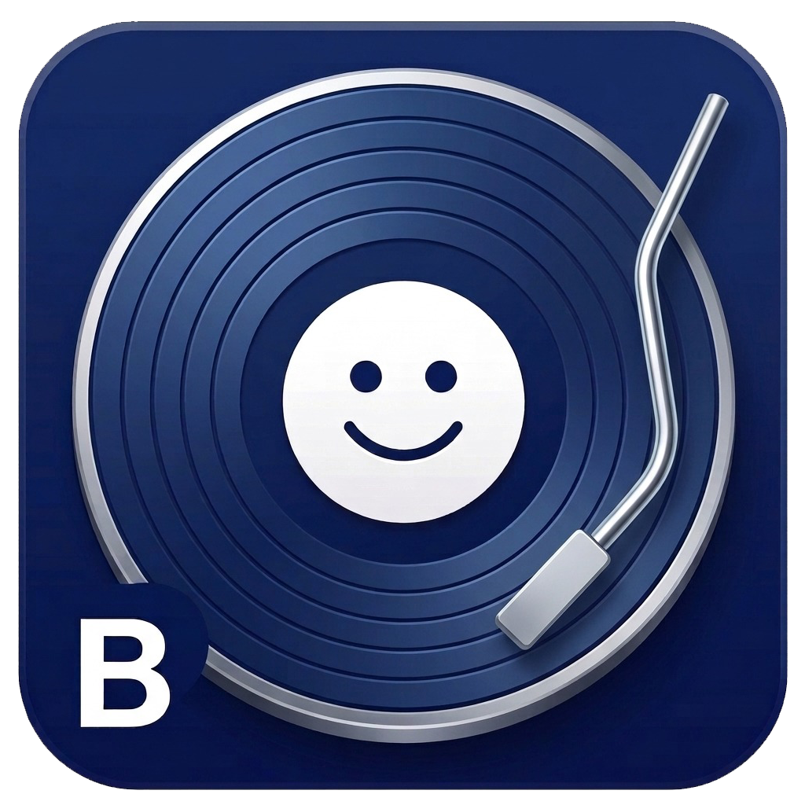

  <div align="center">


  # Lado B - Uma experiência musical
 

<br>
<br>


---
<div align="left">

# Visão geral :

Este repositório é dedicado à disciplina de **Desenvolvimento de Sistemas de Informação (BSI/UFRPE)**. O **Lado B** é um aplicativo mobile voltado a recomendação personalizada de obras musicais, registro, avaliação e análise crítica de produções musicais. A proposta estimula o debate sobre essas obras, permite reunir playlists salvas e desenvolve uma comunidade colaborativa.

## Recomendações, avaliações e playlists

O catálogo incluído em `src/data/albums.json` foi gerado a partir do dataset `aoty.csv`, com 5.000 álbuns. A página inicial ordena os álbuns ainda não avaliados ou salvos pelo usuário pela nota agregada do dataset, ajustada pela média das notas do usuário nos gêneros correspondentes. Sem avaliações, a ordem usa a nota do dataset e o número de avaliações como desempate. A abordagem segue a análise exploratória do projeto [PISI-III](https://github.com/johnpleite/PISI-III); é uma recomendação simples baseada em conteúdo, não uma previsão garantida de preferência.

Ao avaliar um álbum, o app cria o documento `albuns/{albumId}` se ainda não existir, guarda a avaliação em `albuns/{albumId}/avaliacoes/{uid}` e mantém uma cópia em `usuarios/{uid}/avaliacoes/{albumId}` para personalizar recomendações. Ao salvar em uma playlist, o app também garante o documento do álbum e inclui seu ID no array `albumIds` de `usuarios/{uid}/playlists/{playlistId}`. Descrições e serviços de streaming não fazem parte do CSV e só são exibidos quando esses metadados estiverem presentes no documento do álbum; o link para a página de origem do álbum permanece disponível.

Para permitir as leituras e gravações do app, publique as regras de segurança do Firestore em `firestore.rules` no projeto Firebase configurado:

```powershell
npx firebase-tools deploy --only firestore:rules --project lado-b-2ae0d
```

O deploy requer autenticação na CLI do Firebase (`npx firebase-tools login`). As regras permitem que cada usuário acesse somente seus próprios dados e que os metadados de álbuns sejam lidos publicamente.

---

# Equipe e orientação :

**Docentes Orientadores:** Prof. Dr. Gabriel Alves de Albuquerque Júnior; Profa. Dra. Maria da Conceição Moraes Batista.

**Discente:** João Pedro Leite Aires.

---

# Uso de inteligência artificial :

Ferramentas de inteligência artificial foram utilizadas como apoio à elaboração e à atualização da documentação deste repositório. O conteúdo gerado com esse apoio deve ser revisado pela equipe, que mantém a responsabilidade pelas informações publicadas.
